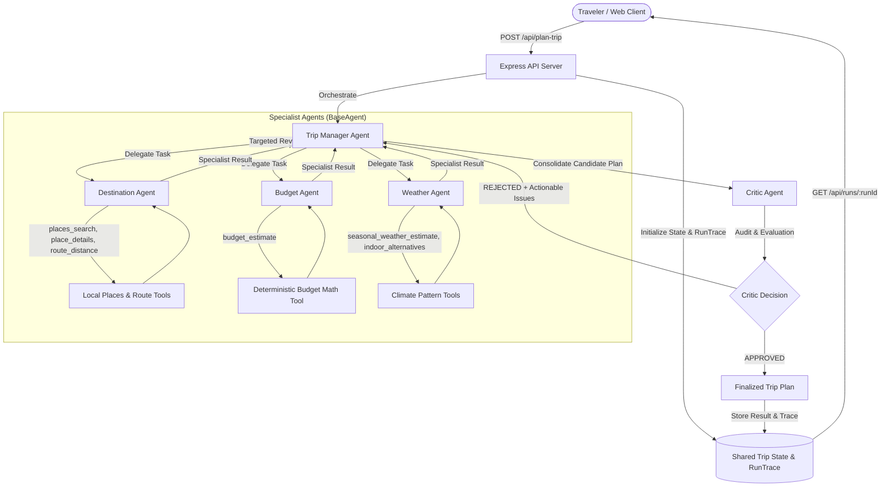

# TripNexus — Multi-Agent AI Travel Planner

> **Academic CA3 Project — Built from scratch with an Agentic Multi-Agent Architecture**

TripNexus is an autonomous, date-aware multi-agent travel planning platform that turns destination choices, group sizes, and budgets into validated, feasible daily itineraries. Rather than relying on a single prompt, TripNexus deploys **five independent AI agents** backed by deterministic tools and an independent evaluation loop.

---

## 🌟 Key Features

1. **Five Independent AI Agents**:
   - **Trip Manager**: Orchestrator dynamically assigning tasks and managing revisions.
   - **Destination Agent**: Selects verified catalog places and estimates route distances.
   - **Budget Agent**: Analyzes group costs in INR with deterministic arithmetic.
   - **Weather Agent**: Assesses date-aligned seasonal climate risks and suggests indoor backups.
   - **Critic Agent**: Audits candidate plans with full authority to approve or reject.
2. **Dynamic Replanning & Critic Feedback Loop**: Rejections trigger targeted revisions to the responsible agent, bounded at a maximum of 3 cycles.
3. **Real Runtime Execution Trace**: Live, filterable chronological timeline of every agent message, model call, and tool execution with JSON export.
4. **High-Throughput LLM Integration**:
   - Powered by **Groq Cloud** (`llama-3.3-70b-versatile` / `llama-3.1-8b-instant`) with 30 RPM and 14,400 RPD on free tier.
   - Built-in **Concurrency Gating** and **Header-Based Backoff** (`Retry-After`) to handle rate limits automatically.
   - Clearly labeled **Deterministic Offline Demo Mode** when API quota or internet is unavailable.
5. **Direct Vercel Deployment**: Configured with `vercel.json` and a serverless API handler (`api/index.js`) for seamless deployment without Replit dependencies.

---

## 🏗️ Architecture Diagram



---

## 🚀 Quick Start (Local Development)

### 1. Prerequisites
- **Node.js**: v20+ (Node v24 recommended)
- **pnpm**: v9+ (`corepack enable && corepack prepare pnpm@latest --activate`)

### 2. Installation
```bash
# Clone the repository
git clone <repo-url>
cd TripNexus-Deployment

# Install workspace dependencies
pnpm install
```

### 3. Environment Setup
Copy the example environment file and add your credentials:
```bash
cp .env.example .env
```
In `.env`:
```env
GROQ_API_KEY=gsk_your_groq_api_key_from_console_groq_com
GROQ_MODEL=llama-3.3-70b-versatile
PORT=5001
```
*(Note: If no API key is provided, TripNexus runs in labeled **Offline Demo Mode** using bundled destination data).*

### 4. Running the Application
```bash
# Terminal 1: Run the API backend (Port 5001)
pnpm run dev:api

# Terminal 2: Run the React frontend (Port 3000)
pnpm run dev:ui
```
Open [http://localhost:3000](http://localhost:3000) in your browser.

---

## ⚡ Deployment to Vercel

TripNexus is fully configured for direct deployment on **Vercel**:

1. **Push your code to GitHub / GitLab**.
2. **Import the project into Vercel**:
   - Framework Preset: **Vite**
   - Root Directory: `./`
   - Build Command: `pnpm run build`
   - Output Directory: `artifacts/tripnexus/dist/public`
3. **Environment Variables**:
   - Add `GROQ_API_KEY` (and optionally `GROQ_MODEL=llama-3.3-70b-versatile`).
4. **Deploy**:
   - Vercel automatically builds the Vite frontend and routes all `/api/*` traffic to the serverless function at `api/index.js`.

---

## 🧪 Automated Testing

Run the full Vitest automated test suite:
```bash
pnpm test
```
The test suite covers:
- Input validation and schema conformance
- Tool authorization and execution via `BaseAgent`
- Multi-agent coordination and dynamic task assignment
- Critic rejection and targeted replanning
- Rate-limit handling and offline fallback logic
- Monotonic execution trace recording

---

## 📚 CA3 Submission Documentation

Detailed project documentation is available in the [`docs/`](./docs) directory:
- [**Project Synopsis**](./docs/synopsis.md): Problem context, solution, and target users.
- [**Design Document**](./docs/design-document.md): Architecture diagram, agent roles, and data flow.
- [**Input Definition**](./docs/input-definition.md): Strict request schema and valid sample input.
- [**Output Definition**](./docs/output-definition.md): API response schema and sample output payload.
- [**Execution Trace Artifact**](./docs/trace-artifact.md): Live trace format, export instructions, and timeline sample.
- [**Demo Video Script**](./docs/demo-script.md): 2–3 minute video presentation walkthrough.
- [**Viva & Oral Exam Guide**](./docs/viva-guide.md): Common viva questions, answers, and team contribution template.

---

## 🛡️ License
MIT License. Developed for academic submission (CA3).
