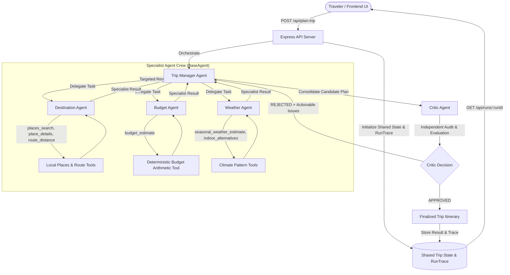

# TripNexus — Multi-Agent System Design Document

## 1. System Architecture Diagram

---

## 2. Agent Responsibilities & Capabilities

| Agent | Role | Responsibilities | Authorized Tools |
| :--- | :--- | :--- | :--- |
| **Trip Manager** | Central Orchestrator | Validates context; dynamically assigns tasks; detects gaps and missing data; routes targeted revisions upon Critic rejection; finalizes plan. | Task delegation & routing |
| **Destination Agent** | Itinerary Specialist | Selects interest-matched attractions from local catalogue; verifies place IDs; calculates straight-line route distances; drafts daily dated activities. | `places_search` `place_details` `route_distance` |
| **Budget Agent** | Financial Evaluator | Interprets deterministic cost breakdowns (accommodation, food, activities, transport, contingency); checks against traveler budget in INR; identifies cost drivers. | `budget_estimate` |
| **Weather Agent** | Climate Specialist | Evaluates seasonal climate patterns for trip dates; assesses outdoor risk (monsoon rain, extreme heat); suggests verified indoor backups. | `seasonal_weather_estimate` `indoor_alternatives` |
| **Critic Agent** | Independent Quality Auditor | Audits dates, pacing, route distances, budget limits, and weather sensitivity; issues independent `APPROVED` or `REJECTED` verdict with evidence. | Evidence evaluation |

---

## 3. Orchestration Pattern: Dynamic Orchestrator-Workers with Evaluator-Optimizer

TripNexus implements a hybrid **Orchestrator-Workers** and **Evaluator-Optimizer** pattern:
1. **Dynamic Task Assignment**: Rather than a static, linear pipeline, the Trip Manager evaluates the shared state and selects specialist delegations with specific tool allowances.
2. **Deterministic Tool Execution**: Arithmetic and catalog lookups are executed in TypeScript to eliminate LLM mathematical hallucinations.
3. **Independent Critique**: The Critic agent does not simply accept previous outputs; it audits the combined schedule against strict constraints.
4. **Targeted Revision Loop**: Upon rejection, the Trip Manager analyzes the issue's `responsibleAgent` and delegates a targeted revision rather than restarting the entire plan from scratch. Bounded at a maximum of 3 full revision cycles to prevent infinite loops.

---

## 4. Shared State Design

The shared state maintained across the lifecycle of each planning run contains:
- `runId`: Unique UUID identifying the planning session.
- `request`: Validated traveler request (destination, dates, travelers, INR budget, interests, pace).
- `candidates`: Verified catalogue place entities retrieved for the destination.
- `itinerary`: Current dated itinerary days with activities, durations, and coordinates.
- `budgetAssessment`: Cost breakdown, total INR estimate, and budget compliance flag.
- `weatherAssessment`: Date-by-date typical climate analysis with risk advisories.
- `criticReports`: History of Critic decisions (`APPROVED` / `REJECTED`), severity, and issues.
- `messages`: Chronological ledger of all agent-to-agent task assignments, tool results, and revisions.
- `executionTrace`: Comprehensive event sequence recorded live during execution.
- `revisionCount`: Current iteration count (bounded at 3).
- `status`: `"queued"` | `"running"` | `"completed"` | `"failed"`.

---

## 5. LLM Integration & Rate Limiting Defense

1. **Provider Strategy**:
   - Primary: **Groq Cloud API** (`llama-3.3-70b-versatile` / `llama-3.1-8b-instant`).
   - Throughput: High-capacity free tier offering **30 RPM** and **14,400 requests/day**.
2. **Rate Limiting & Quota Protections**:
   - **Concurrency Gating**: Serializes agent model calls to prevent concurrent bursts from exceeding token or request rate limits.
   - **Header-Based Backoff**: HTTP 429 (`rate_limit_exceeded`) dynamically parses `Retry-After`, `x-ratelimit-reset-requests`, and `x-ratelimit-reset-tokens` headers with exponential backoff.
   - **Graceful Offline Fallback**: If quota is completely exhausted, the system seamlessly returns a labeled offline demo plan using bundled catalog data, ensuring the application never crashes.

---

## 6. Technology Choices & Justification

- **TypeScript & Node.js**: Type safety, native JSON handling, and strict schema validation with Zod.
- **Express 5**: Fast, minimal REST API routing with structured JSON errors and PDF streaming.
- **Vite & React**: Lightning-fast builds, modern component architecture, and responsive UI.
- **Tailwind CSS & Radix UI**: High-fidelity, accessible UI design meeting modern design standards.
- **Vitest**: Fast, in-memory unit and integration testing with native ESM support.
- **Vercel Serverless**: Seamless cloud hosting with zero infrastructure overhead.
